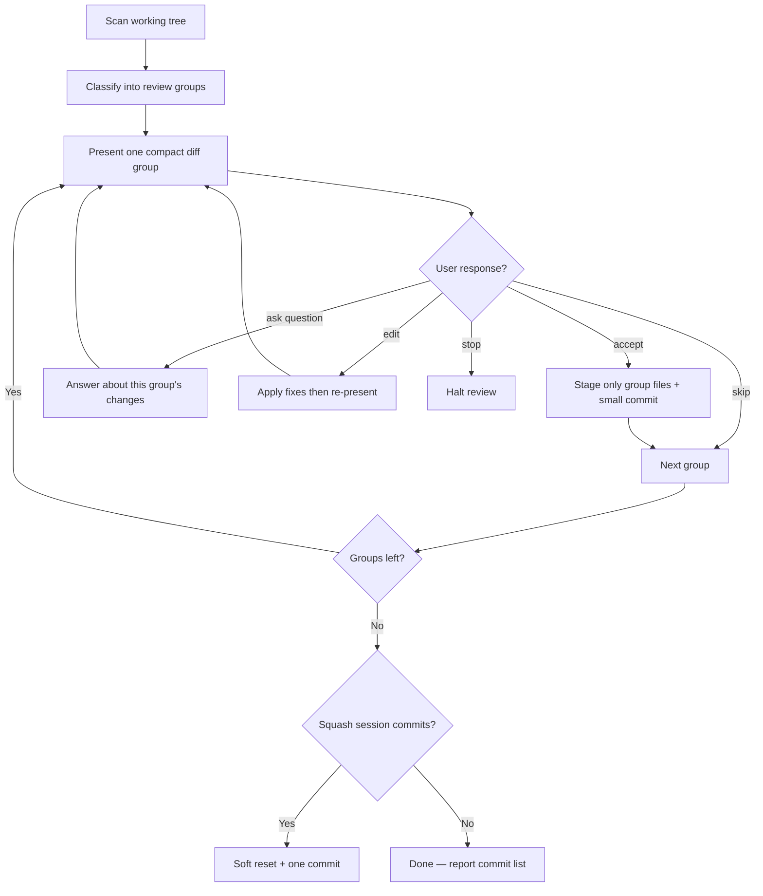

# Layered Review and Commit Workflow

Interactive process for reviewing multi-layer code changes, committing in small accepted slices, and optionally squashing at the end.

## Purpose

Review changes layer by layer instead of blind bulk commits. Each group is shown as a compact unified diff (red removals, green additions); the user can ask questions, accept, skip, or request edits before anything is committed.

## When to use

- Features that span backend schema, controller, routes, frontend service, hooks, and UI
- Working trees with mixed unrelated diffs (feature + local dev toggles + docs)
- Post-implementation cleanup after agent-assisted work

---

## Invoke with `/skill:plan-commit`

| What | Where |
|------|-------|
| Entry point | [../SKILL.md](../SKILL.md) |
| Full workflow (this doc) | [layered-review-and-commit.md](layered-review-and-commit.md) |
| Commit rules | [git-commits.md](git-commits.md) |

Type **`/skill:plan-commit`** in Pi to start layered review.

---

## Workflow overview



---

## Phase 1 — Discover and classify changes

Run read-only git commands first:

```powershell
git status -s
git diff --stat
git log --oneline -10
```

Classify every changed path into a **review group**:

| Group type | Paths (examples) | Merge rule |
|------------|------------------|------------|
| **Schema + DB wiring** | `backend/database/schemas/**`, `backend/database/database.js`, schema index/barrel | Always one group |
| **Controller + barrel** | `backend/controllers/{domain}.js`, `backend/controllers/index.js` | One group per domain |
| **Routes** | `backend/routes/{domain}.js`, mount changes in route index | One group per domain |
| **Backend service facade** | `frontend/src/services/backend/{domain}.js`, service index | One group per domain |
| **Hook / context** | `frontend/src/hooks/*.js`, `frontend/src/context/**` | One group per hook/context |
| **UI** | `frontend/src/app/**`, `frontend/src/components/**` | One group per page/feature |
| **i18n** | `backend/languages/*.json`, `frontend/src/lib/languages/*.js` | One group across all language files |
| **Infra / dev-only** | server entry, HTTPS/HTTP toggles, socket setup | **Never prompt** — see [Local dev exclusions](#local-dev-exclusions) |
| **Docs / plans** | `plan/**`, `plans/**`, `docs/**` | Separate group per doc |

Present groups bottom-up (schema → controller → routes → frontend service → hook → UI). Infra and docs last.

Adapt path patterns to the current repo layout when it differs from the examples above.

### Local dev exclusions

**Do not include in review groups or prompt for commit** unless the user explicitly asks (e.g. "include local dev"):

| File | What changed locally |
|------|----------------------|
| `backend/server.js` | `certificate.generate()` commented out |
| `backend/routes/routes.js` | HTTPS → HTTP for Express |
| `backend/notify/socket/socket.js` | HTTPS → HTTP for Socket.IO |

These are **local dev toggles** on shared production files. They stay unstaged and uncommitted during `/skill:plan-commit`. At scan time, silently omit them from the group list; if the user asks, explain they are local-only.

When presenting the final summary after all groups, optionally one line: *"Left unstaged (local dev): server.js, routes.js, socket.js — not prompted."*

When deduplicating: show one representative diff for identical multi-locale changes; list other files inline.

---

## Phase 2 — Present each group (compact, no scroll)

**Goal:** Each group fits in the chat viewport without scrolling. One screen = one decision.

### Layout rules

- **One group per message** — never batch multiple groups.
- **Header:** one line — `**N/M** {title} · layer · \`commit message\``
- **Files:** one inline line — `files: path/a, path/b`
- **Summary:** max 2 short sentences.
- **Diff:** single ` ```diff ` block — always labeled **Now** (not separate Before/After sections).
- **No Notes section** unless blocking (broken dependency, security issue).
- **Max ~20 diff lines** in chat. If longer, show first 12 + last 4 with `… ({N} lines omitted) …` in the middle.
- **New files:** all lines prefixed with `+` (green). Header: `# new file: path`.
- **Deleted files:** all lines prefixed with `-` (red). Header: `# deleted: path`.
- **Stop command:** user can say **stop** anytime to halt review and update the workflow.

### User responses

After each group, the footer is:

```
accept · ask [question] · skip · edit · stop
```

| Response | Behavior |
|----------|----------|
| **accept** | Stage and commit this group only, then present the next group |
| **ask [question]** | Answer the question about **this group's diff, files, or commit message** — do not commit. Re-show the same group footer when done |
| **skip** | Leave unstaged, move to next group |
| **edit** | Apply requested changes, re-diff, re-present same group |
| **stop** | Halt review, report session commits and remaining groups |

**Ask examples:** `ask why was clinicId removed?` · `ask does this break mobile?` · `ask what calls removeDefault?`

When answering **ask**:
- Stay focused on the current group — read extra files if needed to answer accurately
- Keep answers concise (fits chat without scrolling)
- Do not commit or skip unless the user then says **accept** or **skip**
- End with the same group header + footer so the user can decide

### Template

```markdown
**2/8** Manual controller · backend · `add manual controller`
files: `backend/controllers/manual.js`, `backend/controllers/index.js`

Adds default-manual CRUD logic and exports it from the controller barrel.

**Now**
```diff
--- a/backend/controllers/index.js
+++ b/backend/controllers/index.js
@@ -12,6 +12,7 @@
 export * as loginController from "./login.js";
+export * as manualController from "./manual.js";
 export * as notesController from "./notes.js";
```

```diff
# new file: backend/controllers/manual.js
+export async function getDefaults(auth) { … }
+export async function createDefault(auth, …) { … }
… (130 lines omitted) …
+export async function removeDefault(auth, manualId) { … }
```

accept · ask [question] · skip · edit · stop
```

### Diff source

Always use real git output so `-` / `+` lines render correctly:

```powershell
git diff -- path1 path2          # modified
git diff --no-index NUL path     # new file (Windows)
git diff --cached -- path        # if already staged
```

For new files when diff is too long, show signature only: exports, function names, or first/last 3 lines with `+` prefix.

---

## Phase 3 — Commit on acceptance

- **Never** commit unless the user explicitly **accepts** this group (or otherwise asks you to commit)
- **Never** `git add .` / `git add -A` — stage only the group's named paths
- **Never** push unless asked
- Commit style: short imperative lowercase — e.g. `add manual schema`
- **Subject line only** — no commit body, no `Co-authored-by:` trailers, no URLs, no tool attribution (see [git-commits.md](git-commits.md))
- Use `git commit --no-verify -m "…"` so hooks do not re-inject co-author lines

```powershell
git add path1 path2 ...
git commit --no-verify -m "add manual schema" -- path1 path2 ...
git status -s
```

Track session commits (SHA + message) for squash.

- **ask [question]** — answer about this group, re-present same group (no commit)
- **skip** — leave unstaged, continue
- **edit** — fix, re-diff, re-present same group
- **stop** — halt review, report progress

---

## Phase 4 — Optional squash

After all groups (or after **stop**):

```
Session commits (N):
1. f6a99d9 add manual schema
2. ac49a01 add manual controller
Squash into one commit? yes / no / pick range
Suggested: `add admin manuals feature`
```

Squash only session commits (warn if pushed). Use `git reset --soft HEAD~N` then one commit. Never force-push.

---

## Anti-patterns

- `Co-authored-by:` trailers or links in commit messages
- Long Before + After sections that require scrolling
- Prose descriptions instead of ` ```diff ` blocks
- Mixing infra/dev toggles with feature commits
- Prompting to commit [local dev exclusions](#local-dev-exclusions) (`server.js`, `routes/routes.js`, `notify/socket/socket.js` HTTP toggles)
- Committing without explicit acceptance
- Answering an **ask** by committing or advancing to the next group
- Presenting identical locale diffs separately
